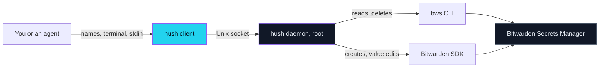

<p align="center">
  
</p>

<p align="center">
  <strong>Your secrets should not need a five-step web ceremony.</strong>
</p>

<p align="center">
  <a href="https://crates.io/crates/bws-tui"></a>
  <a href="https://crates.io/crates/bws-tui"></a>
  <a href="./LICENSE"></a>
  <a href="https://github.com/AojdevStudio/agentic-utilities/actions/workflows/ci.yml"></a>
</p>

<p align="center">
  <code>cargo install --locked bws-tui</code> &nbsp;→&nbsp; <code>hush</code>
</p>

> **Package:** `bws-tui` on crates.io · **Command:** `hush`

## The five-step problem

Adding one secret should take seconds. Instead, the Bitwarden web path means opening a browser, signing in, finding Secrets Manager, finding the right project, and finally creating the secret.

The official `bws` CLI already has the authentication and API access. What it does not have is a fast human interface for the two things you do constantly:

1. put a secret somewhere;
2. find it again without exposing it everywhere.

## The insight

**Do not replace Bitwarden. Make it pleasant, and keep values away from whoever runs the command.**

`hush` keeps no private secret format. A root broker daemon holds the Bitwarden token, reads through the official `bws` CLI, and writes through the official Bitwarden SDK. The `hush` you run holds names only, gives you a focused TUI and predictable commands, and hands your terminal to the daemon when a value must be typed or shown. Bitwarden remains the source of truth, and `hush` removes the ceremony.

## What changes

| Before | With `hush` |
| --- | --- |
| Navigate the web vault to add one value | `hush` → Add → project → key → hidden value prompt |
| Remember which project contains a key | Search every accessible project as you type |
| Print values into terminal scrollback | Reveal on its own screen after password approval, then clear it |
| Repeat browser steps for edits | Edit key or note in place, and replace the value only when you choose to |
| Write one-off shell wrappers for CI | `hush run` starts the command with secrets it never shows you |

## Why it feels quiet

- **Type to find.** Fuzzy filtering is always live, and arrows always move.
- **Enter means actions, never exit.** Copy, Reveal, Edit, Delete, or Cancel appear as plain English.
- **Values stay out of the client.** The `hush` you run holds names only. A root broker daemon holds the token and every value.
- **Your password guards disclosure.** Reveal, copy, edit, and delete ask for your account password on your terminal. Adding a new secret does not.
- **Projects never drift.** The project menu comes live from the vault every time.

## Quick start

`hush` is a client for the hush broker daemon described in [ADR 0002](../docs/adr/0002-hush-broker.md). The daemon runs as root and is the only process that holds the Bitwarden machine-account token. The client needs no token, no `bws` binary, and no config file.

1. Install the crate:

   ```bash
   cargo install --locked bws-tui
   ```

2. Run the daemon as root with its token file. A guided `hush install` for Linux and macOS is planned. Until it lands, the ADR describes the token file, socket, and audit log locations.
3. On Linux, password approval uses the PAM service `hush`, read from `/etc/pam.d/hush`. Without that file, reveal, copy, edit, and delete are refused before any prompt. On macOS, approval uses OpenDirectory and needs no setup.
4. Run `hush`.

Without a reachable daemon, every command except `hush --help` fails with an error that names the socket it tried.

## The interface

### Search and manage

```text
Type                Filter across every accessible project
↑ / ↓               Move through matches
Enter               Open Copy / Reveal / Edit / Delete / Cancel
Esc                 Back out one level
```

Inside the action menu, arrows + Enter are enough. Optional shortcuts are `c` (copy), `r` (reveal), `e` (edit), and `d` (delete). Delete always asks for confirmation first.

Copy, reveal, edit, and delete hand the terminal to the daemon. It shows what you are approving, asks for your account password with echo off, and then acts. Ctrl-C at the prompt cancels. The TUI redraws when the daemon is done.

- **Reveal** shows the value on its own screen until you press Enter, then clears that screen. Control characters in a stored value are shown as escapes, so a value cannot drive your terminal.
- **Copy** sends the value to your terminal's clipboard with OSC 52. The terminal cannot report whether the copy arrived, and `hush` never clears it. Clear it yourself when you are done. Under tmux, enable `set-clipboard on`. Copies are limited to 128 KiB.
- **Edit** keeps the stored value by default. Move to the value field and press Space to replace it. The daemon prompts for the new value after approval.

### Add a secret

```text
hush
  → Add a secret
  → choose a live-fetched project
  → enter the key
  → type the value at the daemon's hidden prompt
```

Add needs no password. It refuses a key that already exists in that project. Replacing a value is an edit, and edits need approval.

## Scripts and CI

Every human operation also works without the TUI:

```bash
hush list
printf '%s' 'not-a-real-secret' | hush add --project "API Keys" --key NEW_SECRET
hush reveal --key DB_PASSWORD
hush edit --key DB_PASSWORD --note "rotated"
hush delete --key OLD_SECRET --yes
```

Project names and UUIDs both work. Without `--project`, reveal, edit, and delete search all accessible projects and require an unambiguous key. Values never go on the command line. Reveal, edit, and delete need an interactive terminal for approval, and `hush reveal` refuses to run when stdout is redirected.

### Multiline values

`add` hands piped stdin to the daemon, which keeps the bytes exactly, including a trailing newline. With a terminal on stdin, the daemon prompts for a one-line value instead. If you press Ctrl-C or the client stops, the daemon stops too and starts no write. A write that may already have reached Bitwarden is reported as uncertain, so check `hush list` before trying again.

```bash
hush add --project "API Keys" --key TLS_PRIVATE_KEY < key.pem
```

For edits, `--stdin` is deliberately explicit so a note-only edit never touches the value:

```bash
hush edit --key TLS_PRIVATE_KEY --stdin < replacement-key.pem
```

## Agent-native use

Coding agents are `hush`'s second user. They can find secrets and use them, and they never see a value.

```bash
# Discover what exists: id, key, project, note. Never values
hush list --json

# Run a command with secrets, started by the broker daemon. Output is masked
hush run --secret CF_API_TOKEN --secret "Cloudflare Admin=CF_ADMIN" -- ./deploy.sh

# Deliver a value on a pipe instead of the environment: the child reads fd $DB_PASSWORD_FD
hush run --fd DB_PASSWORD -- ./migrate.sh
```

- **No client path to a value.** `hush get` and `hush sync` are gone. No command prints a value to stdout, and the client never reads the vault itself.
- **Injection over printing.** `run` is the way to use secrets, and `exec --key` stays an alias of `run --secret` on the same code path. Two bindings targeting the same env name refuse to run. `KEY=ENVNAME` remaps keys that are not valid env var names.
- **Disclosure needs a human.** Reveal and copy need the account password typed on the requesting process's own foreground terminal. An agent without the password cannot approve them.
- **Audit trail.** The daemon writes a names-only line for every catalog read, run, and human request to its own root-owned log. A human line is written before approval and before any write, so it records an attempt, not a completed operation.

## How it works



The client sends names and passes its terminal or stdin to the daemon as open file descriptors. The daemon reads values from those descriptors and writes disclosures straight to the terminal, so no value ever crosses the socket.

## Security model

- **One custodian:** only the daemon holds the token and values. The daemon reads the caller's uid and pid from the kernel, never from the client.
- **Terminal checks:** a passed terminal must be read-write, owned by the caller, the caller's controlling terminal, and the caller's foreground terminal. The daemon checks again just before it discloses anything.
- **Fresh approval:** every reveal, copy, edit, and delete asks for the password again. Nothing is cached.
- **No values in lists, frames, or logs:** search rows hold key and project only. Errors name the operation, never a value.
- **No values in argv:** `bws` takes write values as arguments, which other local users can read, so the daemon creates secrets and replaces values through the Bitwarden SDK instead.
- **No silent overwrite:** add refuses an existing key. The daemon holds one lock across its duplicate check and the write. A writer outside this daemon, such as the web vault, can still create the same key at the same moment, and `hush` cannot see or undo that. Bitwarden trims keys, so a key with leading or trailing whitespace is refused instead of being saved under another name. A key over 500 characters, a note over 7000 characters or made only of whitespace, and a value over 25000 characters or 64 KiB are refused before any lookup or write.
- **Honest failures:** when a write's outcome is unknown, `hush` says so and does not retry. That includes a delete that may have reached the vault before it failed. Check `hush list` first.

The daemon obtains metadata by listing the vault through bws. That listing carries values, which the daemon discards after parsing. The existing 16 MiB output cap can refuse a large vault. Changing that backend contract remains separate in [#80](https://github.com/AojdevStudio/agentic-utilities/issues/80).

### The daemon's run path

The broker trusts every local non-root account to request any vault secret for a run. Kernel peer credentials identify the caller and select the run identity. They do not restrict which secrets that caller may use. Caller allowlisting is tracked separately in [#76](https://github.com/AojdevStudio/agentic-utilities/issues/76).

`hush run` (and `hush exec`) go only through the daemon. For each run the daemon:

- resolves every `--secret` / `--fd` key to one secret id through its catalog and writes an audit line before any fetch,
- picks the run identity: the caller's uid and gid from the kernel, or the dedicated `hushrun` account when `/etc/hush/hushd.toml` lists a bound key under `require_hushrun` (no such account means the run is refused). Root is never a run identity,
- builds the child environment from scratch: the bindings plus `PATH`, `HOME`, `USER`, `LOGNAME`, `LANG`, `LC_*`, `TERM`, `TZ`, and `TMPDIR` from the caller. `BWS_*`, `LD_*`, and `DYLD_*` never reach a child,
- drops to the run identity (`setgroups`, `setgid`, `setuid`), closes every other inherited fd, and starts the child in its own process group in the caller's working directory. The supplementary groups start with the caller's gid and stop at the system limit (`NGROUPS_MAX`, 16 on macOS), so a macOS account in more groups runs without the rest. A bare program name searches the caller's `PATH` as the run identity, so an entry that identity cannot use does not hide a later one. The daemon builds every candidate path before the child starts and refuses a search whose candidates would need more than 1 MiB, the size of one request. Because the search runs only in the child, a mistyped program name fails after the daemon has fetched the bound values. The run then fails at exec, and no program receives them,
- masks every bound value in stdout and stderr as `<hidden by hush>`, forwards stdin and INT, TERM, HUP, and QUIT, and returns the exit code or signal. Values shorter than 8 bytes are not masked, and `hush run` warns once naming the key. A client that disconnects kills the child and its original process group, and anything the child leaves running in that group is killed when the run ends. Stdin flows under a credit window, so a child that never reads stdin cannot grow daemon memory. A stdin read error fails the run and stops the child. A non-blocking stdin with no data yet is not an error. The client tries again every 20 ms until data arrives or the run ends.

`hush run -n` (or `--no-stdin`, also on `exec`) never reads stdin, and the child gets end of input at once, like `ssh -n`. Use it inside a shell `while read` loop and for background runs, so the run does not consume input meant for something else.

Masking is best effort. A command that prints its own secret in a transformed form (for example base64) can still leak that value.

## The story

`hush` started because adding a secret through bitwarden.com was just annoying enough to avoid: a five-step interruption for a five-second task.

The first implementation copied the obvious CLI behavior and printed selected values to terminal scrollback. One real-world test immediately proved why that was wrong. The UX changed: Enter now opens a plain-English action menu, copy is the safe default, reveal is explicit, and the app never exits just because you selected something.

That is the whole design philosophy: **the secure path should also be the path of least resistance.**

## Development

```bash
cargo fmt --check
cargo test
cargo clippy -- -D warnings
cargo publish --dry-run
```

## Contributing

`hush` lives inside [AojdevStudio/agentic-utilities](https://github.com/AojdevStudio/agentic-utilities/tree/main/bws-tui). Bugs and focused improvements belong in that repository's issue tracker.

If the idea saves you a browser trip, star the repo. If the interface makes you think, “this should be one keystroke simpler,” open an issue—that is exactly how `hush` got good.

## License

MIT © Ossie Irondi
